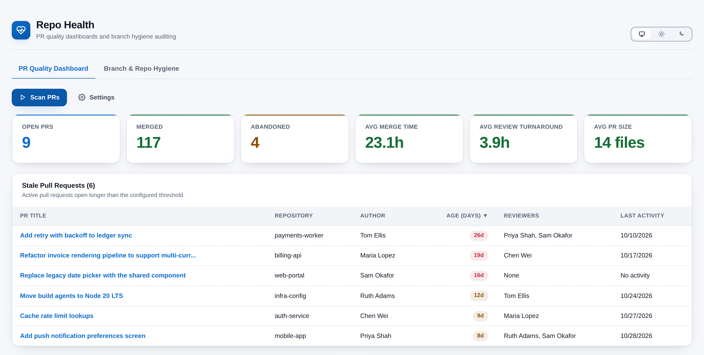
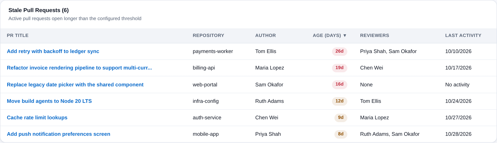
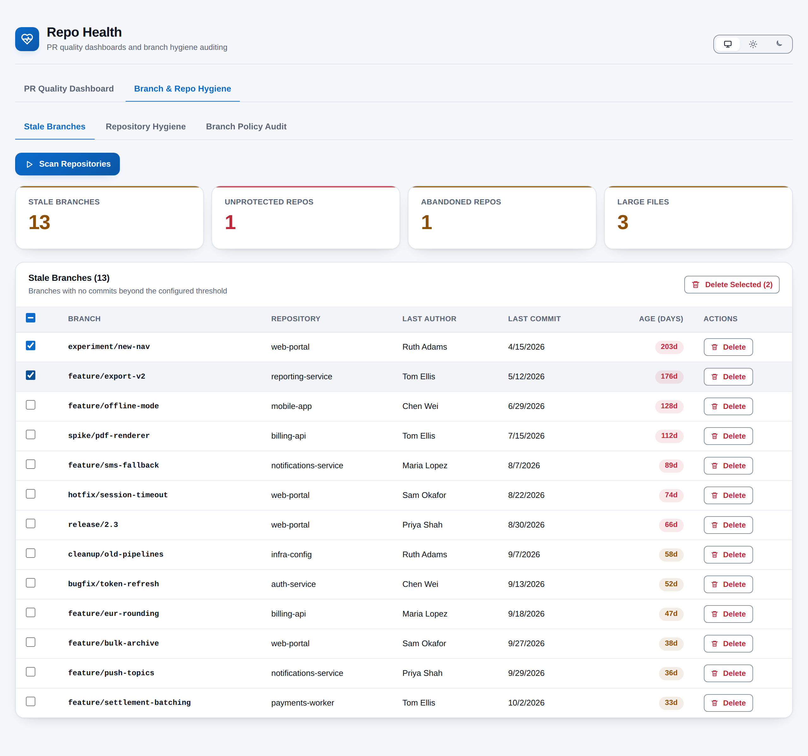
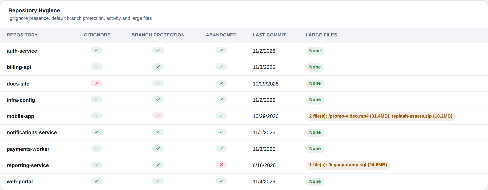

# Repo Health

[](https://github.com/adam-wheater/azure-devops-repo-health/actions/workflows/ci.yml)

An Azure DevOps extension that monitors repository health from two dashboards. The **PR Quality Dashboard** tracks pull request volume, merge and review times, PR size, stale PRs, reviewer load and contributor activity. **Branch & Repo Hygiene** finds stale branches (and lets you delete them safely), audits branch policies on default branches, and flags repositories with no `.gitignore`, no protection, no recent commits or oversized files. It is for the team leads and repository owners who need to answer one question: *are our repositories and review habits in good shape, and what needs cleaning up?* It adds a **Repo Health** hub under **Repos** in every project, and everything runs in the browser against your organisation's Azure DevOps REST API.



## Table of contents

- [Getting started](#getting-started)
- [Features](#features)
- [Screens](#screens)
  - [PR Quality Dashboard](#pr-quality-dashboard)
  - [Branch & Repo Hygiene](#branch--repo-hygiene)
- [How it works](#how-it-works)
- [Settings](#settings)
  - [PR dashboard (`pr-dashboard-settings`)](#pr-dashboard-pr-dashboard-settings)
  - [Hygiene (`hygiene-settings`)](#hygiene-hygiene-settings)
- [Rules and detection logic](#rules-and-detection-logic)
- [Scopes & permissions](#scopes--permissions)
- [Privacy](#privacy)
- [Troubleshooting and known limitations](#troubleshooting-and-known-limitations)
- [Development](#development)
- [Project structure](#project-structure)
- [Tech stack](#tech-stack)
- [Contributing](#contributing)
- [License](#license)

## Getting started

1. Install **Repo Health** by publisher `adam-wheater` from the Visual Studio Marketplace (the listing carries the **Preview** flag).
2. Open a project. The hub is contributed to the **Repos** hub group (`ms.vss-code-web.code-hub-group`, order 99) and appears last in the Repos menu as **Repo Health**.
3. The first visit opens on **PR Quality Dashboard** with an empty state. Settings load in the background (defaults when none are saved). Nothing is scanned until you press **Scan PRs** or, on the hygiene tab, **Scan Repositories**. Results are not cached between visits.
4. Adjust thresholds in **Settings** and press **Save**. Saved values apply to everyone in the organisation.

## Features

- **PR summary** -- Open, merged and abandoned counts plus average merge time, review turnaround and PR size (files changed) across every repository in the project.
- **Stale PR detection** -- Active pull requests older than a configurable threshold, in a sortable table with age pills.
- **Weekly frequency chart** -- Created vs merged pull requests per week for the last 12 weeks, drawn as client-side SVG.
- **PR size analysis** -- Small / Medium / Warning / Large buckets by files changed, with configurable thresholds and proportion bars.
- **Review load distribution** -- The 15 busiest reviewers by PR assignments, self-reviews excluded.
- **Contributor statistics** -- A sortable per-user table of PRs authored and reviewed, first-review time, PR size and comment activity.
- **Auto-complete tracking** -- How many completed PRs used auto-complete vs a manual merge.
- **Stale branch detection** -- Branches whose last commit is older than a threshold, following the refs API continuation token so big repositories are not truncated; default, `main`, `master` and `develop` branches are never listed.
- **Safe branch deletion** -- Delete one branch or a selection after a confirmation dialog; deletion is a ref update from the scanned object id, so a branch that moved since the scan is not deleted.
- **Branch policy audit** -- Minimum reviewers, build validation and comment resolution on each default branch, counting project-level (inherited) policies.
- **Repository hygiene report** -- `.gitignore` presence, default-branch protection, abandoned status and large files per repository.
- **Cancellable scans** -- Both scans run under an `AbortController`; **Cancel** stops issuing new requests and the late result is discarded.
- **Paged fetching with a concurrency cap** -- PRs are paged 100 at a time and at most 5 repositories are processed in parallel.
- **Persistent settings** -- PR dashboard thresholds are saved through the Azure DevOps Extension Data Service.
- **Theme follows Azure DevOps** -- Light, dark and high contrast come from the host's `themeApplied` event, with a header toggle to pin light or dark; the toggle hides under a high-contrast theme or OS forced colours.
- **WCAG AA contrast** -- Both palettes are audited to 4.5:1 for text and 3:1 for UI, and pass/fail states carry an icon and a screen-reader label, never colour alone.

## Screens

The hub has two tabs, **PR Quality Dashboard** and **Branch & Repo Hygiene**. Each has its own scan button, and the hygiene tab has three sub-tabs.

### PR Quality Dashboard

#### Toolbar, progress and errors

- **Scan PRs** (primary) starts a scan. It stays disabled until saved settings have loaded. While it runs the button reads **Scanning...** with a spinner and is disabled, and a **Cancel** button appears.
- **Settings** (ghost button) toggles the settings panel and reads **Hide Settings** while it is open (`aria-expanded`).
- Progress is shown as an info banner with the messages "Initializing...", "Fetching repositories..." and "Scanning PRs across N repositories...".
- Failures appear in a dismissible error banner as `Scan failed: <reason>`.
- Before the first scan, an empty state reads "Click **Scan PRs** to analyze pull request quality across your repositories."
- The dashboard stays mounted when you switch tabs, so its results survive a visit to the hygiene tab.

#### Summary bar

| Metric | Formula | Tone |
|--------|---------|------|
| **Open PRs** | Count of active PRs (all ages). | Accent |
| **Merged** | Completed PRs created inside the time period. | Success |
| **Abandoned** | Abandoned PRs created inside the time period. | Warn |
| **Avg Merge Time** | Mean of `closedDate - creationDate` over completed PRs. | Danger > 48 h, else success |
| **Avg Review Turnaround** | Mean of `firstReviewDate - creationDate` over PRs that have one (negative values ignored). `firstReviewDate` is the earliest `publishedDate` of a non-deleted comment thread whose first comment was written by someone other than the author. | Warn > 24 h, else success |
| **Avg PR Size** | Mean files changed over PRs with at least one file, shown as `N files`. | Warn > 20 files (fixed), else success |

Durations are formatted as minutes below 1 h (`45m`), hours below 24 h (`4.2h`) and days otherwise (`1.3d`).

#### Stale pull requests



Card title `Stale Pull Requests (N)`. A PR is stale when it is active and older than **Stale PR threshold** days (strictly greater).

| Column | Definition |
|--------|------------|
| **PR Title** | Link to the PR's `url`, opening in a new tab. Titles over 60 characters are cut to 57 plus `...`, with the full title as a tooltip. |
| **Repository** | Repository name. |
| **Author** | `createdBy.displayName`. |
| **Age (days)** | Whole days since creation, shown as an `Nd` pill: danger above 14 days, otherwise warn. |
| **Reviewers** | Reviewer names, comma-separated, or "None". |
| **Last Activity** | Date of the latest comment, vote or push, or "No activity". Not sortable. |

Sorted by age, oldest first (descending). Click a header to sort by it (descending first) and click again to reverse; **Reviewers** sorts by reviewer count. The active header exposes `aria-sort`. Empty state: "No stale pull requests found."

#### Weekly PR frequency

Twelve weekly buckets, each keyed by the local date of the Monday that starts the week, from 11 weeks ago up to the current week. **Created** counts PRs by creation week; **Merged** counts completed PRs by `closedDate` week. The chart draws paired bars (chart series 1 for created, series 2 for merged), y-axis labels and dashed grid lines at 0, 25, 50, 75 and 100 % of the maximum, x labels rotated 45 degrees, and a tooltip on every bar (`Week of <date>: N created` / `N merged`). A text legend with colour swatches sits above the chart. The SVG is 904 px wide, has `role="img"` and an `aria-label`, and scrolls horizontally inside its card whenever the card is narrower than that.

#### Review load distribution

The top 15 reviewers by number of PR assignments across all scanned PRs, ties broken by name. The author is never counted as their own reviewer. Each row shows the name (truncated, with a tooltip), a bar scaled to the busiest reviewer (`role="meter"`, with an `aria-label` such as `Ana: 12 reviews`) and the count. Empty state: "No reviewer data available."

#### PR size distribution

Every scanned PR is placed in a bucket by files changed. `medium = max(5, floor(warning / 2))`.

| Bucket | Range | Default label | Tone |
|--------|-------|---------------|------|
| Small | `< medium` | Small (<10 files) | Success |
| Medium | `medium <= files < warning` | Medium (10-20) | Accent |
| Warning | `warning <= files < large` | Warning (20-50) | Warn |
| Large | `>= large` | Large (50+) | Danger |

Each tile shows the count, `N% of PRs` and a bar of that proportion. PRs whose file count could not be read have 0 files and land in Small.

#### Contributor statistics

Default sort: **PRs Authored**, descending. Every column is sortable.

| Column | Definition |
|--------|------------|
| **Name** | Display name, keyed by identity id. |
| **PRs Authored** | PRs the user created. |
| **PRs Reviewed** | PRs where the user is a reviewer, excluding their own. |
| **Avg First Review** | Mean hours from PR creation to the user's first comment or vote, as a pill (warn > 24 h, else success); `-` when there is no data. |
| **Avg PR Size** | Mean files changed over authored PRs, as `N files`; `-` when 0. |
| **Comments Given** | Over reviewed PRs, the fraction of PRs that had at least one comment thread (from anyone), to one decimal. |
| **Comments Received** | Mean number of comment threads on the user's authored PRs, to one decimal. |

Empty state: "No user statistics available."

#### Auto-complete tracking

Over completed PRs: **Auto-Complete** (accent) counts PRs with `autoCompleteSetBy` or `completionQueueTime` set, **Manual Merge** counts the rest, and **Auto-Complete %** (success tone) is `auto / completed`, to one decimal.

#### Dashboard settings panel

The panel is titled **Dashboard Settings** and has four numeric fields, each with help text linked through `aria-describedby`. Values must be positive whole numbers; an empty, zero or negative entry falls back to that field's default.

- **Save** applies the values to the dashboard straight away and writes them to the Extension Data Service. A **Settings saved!** pill (`role="status"`) shows for 2 seconds. A failed write is logged to the console only. The panel stays open.
- **Reset to Defaults** resets the fields in the panel. Press **Save** to keep the change.
- New thresholds take effect on the next scan. Size buckets re-render immediately from the current data.

The panel's hint says the thresholds persist "for this project". They are in fact stored in the organisation-wide Default scope (see [Settings](#settings)).

### Branch & Repo Hygiene

#### Scan toolbar

Three sub-tabs share one scan: **Stale Branches**, **Repository Hygiene** and **Branch Policy Audit**.

- **Scan Repositories** (primary) and **Cancel** behave as on the PR dashboard.
- Progress is an info banner: "Initializing...", "Fetching repositories...", then `Scanning <repo>... (n/total)`.
- Failures appear as `Scan failed: <reason>` in a dismissible banner.
- Before the first scan, an empty state reads "Click **Scan Repositories** to audit branch and repository hygiene."
- Results persist while you switch between tabs. There is no settings panel on this tab (see [Settings](#settings)).

#### Stale Branches



Four summary tiles head this sub-tab:

| Tile | Formula | Tone |
|------|---------|------|
| **Stale Branches** | Number of stale branches (recomputed after each deletion). | Warn if > 0, else success |
| **Unprotected Repos** | Repositories whose default branch has **neither** a minimum-reviewers **nor** a build-validation policy. | Danger if > 0, else success |
| **Abandoned Repos** | Repositories flagged abandoned. | Warn if > 0, else success |
| **Large Files** | Total large files across repositories. | Warn if > 0, else success |

The table is titled `Stale Branches (N)` and sorted by age descending, then repository name. It is not re-sortable.

| Column | Definition |
|--------|------------|
| *(checkbox)* | Select the row. The header checkbox selects all and shows an indeterminate state for a partial selection. |
| **Branch** | Branch name without `refs/heads/`, monospace. |
| **Repository** | Repository name. |
| **Last Author** | `author.name` of the branch's latest commit. |
| **Last Commit** | Date of the latest commit (`committer.date`, falling back to `author.date`), in the browser locale. |
| **Age (days)** | Whole days since that commit, as an `Nd` pill: danger above 60 days, otherwise warn. |
| **Actions** | **Delete** button (danger, `aria-label="Delete <branch>"`). |

When rows are selected, **Delete Selected (N)** appears in the card header. N counts only branches still in the table. Empty state: "No stale branches found."

#### Branch deletion

- **Single:** clicking **Delete** opens a modal titled **Delete Branch**: `Are you sure you want to delete branch "<name>" from repository "<repo>"? This action cannot be undone.`
- **Bulk:** **Delete Selected (N)** opens **Delete Branches**: `Are you sure you want to delete N branch(es)? This action cannot be undone.` The selection is cleared when the dialog opens.
- **The dialog:** the confirm button reads **Delete** (danger) next to **Cancel**. The modal traps focus, closes on Escape or a backdrop click, and restores focus afterwards.
- **The ref update:** each branch is deleted with `GitRestClient.updateRefs([{ name: "refs/heads/<branch>", oldObjectId: <objectId at scan time>, newObjectId: "0000000000000000000000000000000000000000" }])`. If the branch has moved since the scan, Azure DevOps rejects the update and nothing is deleted. `updateRefs` resolves even on rejection, so the per-ref `success` flag is checked and a rejection becomes an error (`Could not delete branch "<name>": <customMessage or updateStatus>`).
- **Bulk order:** bulk deletes run one at a time and carry on after a failure. Only deleted branches leave the table. Failures are listed as `Failed to delete N of M branch(es): repo/branch: reason; ...`.

#### Repository Hygiene



| Column | Check | Shown as |
|--------|-------|----------|
| **.gitignore** | `getItem(repo, ".gitignore")` succeeds, so a root `.gitignore` exists. | Good / Issue pill |
| **Branch Protection** | At least one enabled policy configuration has a scope covering the default branch (any policy type). | Good / Issue |
| **Abandoned** | The latest commit (`getCommits`, `$top 1`) is more than **abandoned threshold** days old. A repository with no commits is not abandoned. | Good when not abandoned, Issue when abandoned |
| **Last Commit** | Date of that commit, or "Never". | Muted text |
| **Large Files** | Non-folder items from `getItems(repo, "/", "Full")` whose `size` exceeds **large file size** MB. | Warn pill `N file(s): path (size), ...`, or success pill "None" |

Good / Issue pills use a check or cross icon, a `title`, and screen-reader text. Sorted by repository name. If a repository fails outright it is listed with every check as an Issue. Empty state: "No repository hygiene data available."

#### Branch Policy Audit

For each repository's default branch, a policy counts when it is enabled and one of its scopes applies (see `scopeAppliesTo` in [rules](#rules-and-detection-logic)).

| Column | Definition |
|--------|------------|
| **Repository** | Name. |
| **Default Branch** | Short branch name (defaults to `main` when the repository reports none). |
| **Min Reviewers** / **Build Validation** / **Comment Resolution** | Enabled / Disabled pill per policy type. |
| **Total Policies** | Count of all enabled policies covering the default branch, followed by `(N inherited)` when some come from project-level scopes. |

Sorted by repository name. Empty state: "No policy data available."

## How it works

```
   SDK.init() -> SDK.ready() --> ThemeProvider (data-theme / data-contrast) --> <App/>
                                                                                  |
   IProjectPageService.getProject() -> project name                               |
   GitRestClient.getRepositories(project)                                         |
        |                                                                         |
        +--> PR Quality Dashboard (PrDataService)          +--> Hygiene (BranchHygieneService)
        |    ConcurrencyLimiter(5) over repos               |    PolicyRestClient.getPolicyConfigurations(project)  (once)
        |    for status in Active, Completed, Abandoned:    |    ConcurrencyLimiter(5) over repos, per repo in parallel:
        |      getPullRequests(repo, {status,               |      getRefs("heads/", continuationToken...)
        |        targetRefName: defaultBranch}, skip, 100)  |        -> getCommits($top 1, branch) per branch
        |      per PR: getThreads + getPullRequestIterations|      getItem(".gitignore"), getCommits($top 1)
        |              -> getPullRequestIterationChanges    |      getItems("/", "Full")
        v                                                   v
   summary, stale PRs, user stats, weekly buckets     stale branches, policy audit, hygiene reports
        |                                                   |
        v                                                   v       updateRefs([{oldObjectId -> 000...0}])
   React components (Metric, Card, Pill, SortHeader, SVG)           on confirmed delete
        ^
        |  ExtensionDataService, collection "repo-health-settings"
        +--- "pr-dashboard-settings"  (read + written by the Settings panel)
        +--- "hygiene-settings"       (read only; no UI writes it)
```

1. **SDK init.** `src/RepoHealthHub/RepoHealthHub.tsx` runs `SDK.init()` and `SDK.ready()`, then renders `<App/>` inside `ThemeProvider`. If the handshake fails, a plain-DOM message ("Repo Health could not connect to Azure DevOps. Refresh the page to try again.") and the error text are shown.
2. **Project context.** Each scan asks `IProjectPageService.getProject()` for the current project, then `GitRestClient.getRepositories(project)` for its repositories. It fails with "No repositories found in this project." if there are none.
3. **PR scan.** `PrDataService.buildDashboard` drops any repository in `excludedRepoIds`, then for up to 5 repositories at a time fetches Active, Completed and Abandoned pull requests that target the repository's default branch. It pages with `skip` / `top = 100` until a short page comes back. Completed and abandoned PRs arrive newest first, so paging stops once a page runs past the time-period cutoff, and closed PRs created before the cutoff are dropped. Every PR is then enriched one at a time: `getThreads` and `getPullRequestIterations` in parallel, then `getPullRequestIterationChanges` for the last iteration.
4. **Hygiene scan.** `BranchHygieneService.scanAllRepos` fetches the project's enabled policy configurations once. Then, for up to 5 repositories at a time, it finds stale branches, evaluates policies and runs the hygiene checks in parallel, reporting `Scanning <repo>... (n/total)` as it goes.
5. **Cancellation.** The `AbortSignal` is checked before each repository, status, page and PR (PR scan) and before each repository (hygiene scan). Requests already in flight finish, but their results are discarded and the UI is not updated.
6. **Computation.** Summary averages, stale PRs, per-user statistics, 12 weekly buckets, size buckets and reviewer load; stale branches, policy flags, protection, abandonment and large files.
7. **Persistence.** `SettingsService` reads and writes documents in the Extension Data Service collection `repo-health-settings`, in the extension's **Default (collection-wide)** scope: one copy shared by the whole organisation, not per user or per project.

## Settings

All settings live in the Extension Data Service collection `repo-health-settings`, in the Default (collection-wide) scope.

### PR dashboard (`pr-dashboard-settings`)

| Setting | Field | Default | Validation | Effect |
|---------|-------|---------|------------|--------|
| **Stale PR threshold (days)** | `stalePrThresholdDays` | 7 | integer >= 1 | Active PRs older than this are listed as stale. |
| **PR size warning threshold (files)** | `prSizeWarningLines` | 20 | integer >= 1 | Lower bound of the Warning bucket; half of it (min 5) is the Medium lower bound. |
| **PR size large threshold (files)** | `prSizeLargeLines` | 50 | integer >= 1 | Lower bound of the Large bucket. |
| **Time period (days)** | `timePeriodDays` | 30 | integer >= 1 | Cutoff for completed and abandoned PRs (active PRs are always included). |
| *(no UI)* | `excludedRepoIds` | `[]` | -- | Repository ids skipped by the PR scan. Honoured if present in the stored document. |

The field names say "Lines" for historical reasons; the values are file counts. The **Avg PR Size** tile uses a fixed 20-file threshold, not this setting.

### Hygiene (`hygiene-settings`)

| Setting | Field | Default | Effect |
|---------|-------|---------|--------|
| Stale branch threshold | `staleBranchThresholdDays` | 30 days | Branches whose last commit is older are stale. |
| Abandoned repo threshold | `abandonedRepoThresholdDays` | 90 days | Repositories whose latest commit is older are abandoned. |
| Large file size | `largeFileSizeMb` | 10 MB | Files above this size are listed. |

These are read at load, but there is **no settings UI for them** and nothing in the extension writes this document. In practice the defaults apply. `excludedRepoIds` is not applied to the hygiene scan.

The theme choice is separate: it is kept in browser `localStorage` under `repo-health.theme` (`light` or `dark`; absent means follow Azure DevOps).

## Rules and detection logic

| Rule | Trigger | Severity / display | Tune or disable |
|------|---------|--------------------|-----------------|
| **Stale PR** | status active and `now - creationDate > stalePrThresholdDays` | Row in Stale PRs; pill danger if age > 14 d, else warn | `stalePrThresholdDays`; 14-day danger line fixed. |
| **Slow merge** | mean merge time > 48 h | Avg Merge Time tile danger | Fixed. |
| **Slow review** | mean review turnaround > 24 h (tile) / user's mean first review > 24 h (table) | Warn | Fixed. |
| **Large average PR** | mean files changed > 20 | Avg PR Size tile warn | Fixed. |
| **PR size bucket** | files vs `max(5, floor(warning/2))`, `warning`, `large` | Success / accent / warn / danger tile | `prSizeWarningLines`, `prSizeLargeLines`. |
| **Stale branch** | not the default branch, not `main` / `master` / `develop`, and `now - lastCommit > staleBranchThresholdDays` | Row; pill danger if age > 60 d, else warn | `staleBranchThresholdDays` (stored only); exclusions fixed. |
| **Minimum reviewers policy** | policy type id `fa4e907d-c16b-4a4c-9dfa-4916e5d171ab`, or type display name containing "minimum number of reviewers" | Enabled / Disabled | Configure the policy in Azure DevOps. |
| **Build validation policy** | type id `0609b952-1397-4640-95ec-e00a01b2c241`, or display name containing "build" | Enabled / Disabled | As above. |
| **Comment resolution policy** | type id `c6a1889d-b943-4856-b76f-9e46e181b22d`, or display name containing "comment" | Enabled / Disabled | As above. |
| **Policy scope match** (`scopeAppliesTo`) | scope has no `repositoryId` (project-wide) or matches the repo; and has no `refName` (all branches), or `matchKind` prefix and the default ref starts with it, or exact match | Decides whether a policy counts | -- |
| **Unprotected repo** | neither minimum-reviewers nor build-validation applies to the default branch | Unprotected Repos tile danger | Add either policy. |
| **Branch protection** | any enabled policy applies to the default branch | Good / Issue | Add any policy. |
| **Missing .gitignore** | no root `.gitignore` | Issue | Add the file. |
| **Abandoned repo** | days since latest commit > `abandonedRepoThresholdDays` | Issue; Abandoned Repos tile warn | `abandonedRepoThresholdDays` (stored only). |
| **Large file** | file `size > largeFileSizeMb x 1024 x 1024` | Warn pill; Large Files tile warn | `largeFileSizeMb` (stored only). |
| **High contrast** | OS `forced-colors: active`, or the host's primary text, secondary text and background are all pure black / white | Host palette, theme toggle hidden | Heuristic; not configurable. |

## Scopes & permissions

| Scope | API calls that need it |
|-------|------------------------|
| `vso.code_write` | Read: `GitRestClient.getRepositories`, `getPullRequests`, `getThreads`, `getPullRequestIterations`, `getPullRequestIterationChanges`, `getRefs`, `getCommits`, `getItem`, `getItems`, and `PolicyRestClient.getPolicyConfigurations` (all covered by the code read scope this one includes). Write: `GitRestClient.updateRefs` for branch deletion, which is the reason write access is requested. |
| `vso.extension.data` | `IExtensionDataManager.getDocument` / `setDocument` for the settings documents. |
| `vso.project` | No REST call needs it directly: the project comes from the host `IProjectPageService` and every route above is project-scoped. It is requested conservatively. |

Branch deletion still needs the signed-in user to have the Git **Delete or manage branches** (Force push) permission on the repository; the scope alone does not grant it.

## Privacy

Everything runs in the browser inside the Azure DevOps extension iframe. Repository, pull request, branch and policy data are read from your organisation's Azure DevOps REST API and never leave it. There is no backend, no telemetry and no call to any third-party host. The only write besides settings is the branch deletion you confirm.

| Data | Where | Scope |
|------|-------|-------|
| `stalePrThresholdDays`, `prSizeWarningLines`, `prSizeLargeLines`, `timePeriodDays`, `excludedRepoIds` | Extension Data Service, collection `repo-health-settings`, document `pr-dashboard-settings` | Default scope: shared across the organisation |
| `staleBranchThresholdDays`, `abandonedRepoThresholdDays`, `largeFileSizeMb` (read only) | Same collection, document `hygiene-settings` | Default scope |
| Pinned theme (`light` / `dark`) | Browser `localStorage`, key `repo-health.theme` | This browser only |

Scan results stay in memory and are discarded when you leave the page.

## Troubleshooting and known limitations

- **Only PRs targeting each repository's default branch are scanned** (`targetRefName: defaultBranch`). PRs into release or feature branches are not counted anywhere.
- **"Comments Given" is not the reviewer's own comments.** It is the share of the PRs they review that have any comment thread at all.
- **PR enrichment is sequential per repository.** Each PR costs two or three requests. Large projects with long time periods take a while; shorten the period or use **Cancel**.
- **Cancel does not abort in-flight requests.** It stops new ones and discards the result.
- **Files changed comes from one `getPullRequestIterationChanges` call** for the last iteration. If that call and the fallback both fail, the PR counts as 0 files (Small bucket) and is left out of the average.
- **The PR title link uses the `url` field from the Git REST payload.** That field may be the REST resource URL rather than the web page, depending on the server. Unverified against a live organisation.
- **Hygiene thresholds cannot be changed in the UI.** The defaults (30 / 90 days, 10 MB) apply unless the `hygiene-settings` document is written by other means.
- **Policy configurations are fetched in a single call** without following a continuation token. In projects with a very large number of policies, some may be missed.
- **"Unprotected Repos" and "Branch Protection" measure different things.** The tile requires minimum-reviewers or build-validation; the column accepts any policy.
- **Large-file detection depends on the items API returning `size`.** Items without a size are never flagged. Only the root `.gitignore` is checked.
- **Branch exclusions are fixed.** `main`, `master`, `develop` and the default branch are always skipped, whatever their age.
- **Deleting a branch needs repository permission** in addition to the extension scope. A refused update appears in the error banner with the server's reason, and the branch stays listed. If the branch moved after the scan, re-scan and try again.
- **Weekly buckets use the browser's local time** (Monday-start weeks).
- **Settings are organisation-wide.** The settings panel says "for this project", but the documents are in the Default (collection-wide) scope, so one user's Save changes the thresholds for everyone.
- **High-contrast detection is a heuristic**, triggered by pure black and white host colours or by OS forced colours.
- **"Could not determine the current project."** / **"Could not determine project."** means the hub was opened outside a project context.
- **"Repo Health could not connect to Azure DevOps."** means `SDK.init()` failed; refresh the page.
- **Re-consent.** If a future version changes the requested scopes, organisation administrators must re-authorise the extension in **Organization settings > Extensions**.

## Development

### Prerequisites

- Node.js 20 or later (`engines.node >= 20`) and npm.
- Install with `npm ci --legacy-peer-deps` (or `npm install --legacy-peer-deps`). The flag is required because of the Azure DevOps SDK and React 18 peer ranges, and CI uses it too.

### npm scripts

| Script | What it does |
|--------|--------------|
| `npm run build` | Production webpack build into `dist/`; `postbuild` runs `scripts/verify-bundle.js`, then `scripts/third-party-notices.js`. |
| `npm run build:dev` | Development build with source maps (CSS still extracted to a file). |
| `npm run screenshots` | Builds the hub on sample data and saves the screenshots to `static/screenshots/` (see below). |
| `npm run verify:bundle` | Re-checks an existing `dist/` without rebuilding. |
| `npm run package` | `tfx extension create` -> `out/*.vsix`. |
| `npm test` | Jest, all projects, verbose. |
| `npm run lint` / `npm run lint:fix` | ESLint 9 flat config over `src/` and `tests/`. |
| `npm run format` / `npm run format:check` | Prettier over `src/**/*.{ts,tsx}` and `tests/**/*.{ts,tsx}`. |
| `npm run publish:marketplace` | `tfx extension publish` with `vss-extension.json`. |

### Run it locally with sample data

`demo/` builds the real hub against stand-ins for the Azure DevOps SDK and REST clients, filled with a fictional "Contoso" project. Use it to try the UI without an organisation, and to refresh the screenshots:

```sh
npm i --no-save playwright && npx playwright install chromium   # once
npm run screenshots
```

After that, open `demo/dist/RepoHealthHub/RepoHealthHub.html` in a browser to click around. `demo/api.ts` holds the sample data and `demo/shots.json` lists the screenshots; the other files in `demo/` are the same in every extension. Nothing in `demo/` ships in the package.

### `build.ps1`

`build.ps1` is the same script in every extension repository (it reads the product name from `vss-extension.json`) and runs the CI steps locally, in CI order:

1. `npm ci --legacy-peer-deps` (the same install as `ci.yml`).
2. `npm run lint` and `npm run format:check`.
3. `npm test`.
4. Bump the version in `vss-extension.json`, `package.json` and both root entries of `package-lock.json` (semver patch +1, e.g. 1.0.9 -> 1.0.10). If any later step fails, all three files are restored.
5. `npm run build` (including `postbuild` bundle verification) and `npm run package`.
6. Check that `out/adam-wheater.<id>-<version>.vsix` exists. If it does not, the script fails instead of reporting an older package.

| Parameter | Effect |
|-----------|--------|
| `-Version 1.1.0` | Release exactly this version instead of the patch bump. |
| `-NoBump` | Package the current version unchanged (cannot be combined with `-Version`). |
| `-SkipInstall` | Reuse the existing `node_modules`. |
| `-SkipTests` | Skip `npm test`. |
| `-SkipChecks` | Skip lint and format check (CI still enforces both). |

The committed version is 1.0.0. `.github/workflows/ci.yml` runs the same install, lint, format check, tests, build, bundle verification and packaging on Node 20, then uploads the `.vsix`.

### Tests

`jest.config.js` defines two projects sharing one `moduleNameMapper` (`@/` alias, CSS -> `styleMock.js`, SDK and API -> `tests/__mocks__`, which provide controllable `GitRestClient` / `PolicyRestClient` stubs through `__setMockClient`):

- **unit** -- `testEnvironment: node`, everything under `tests/` except `tests/components/`:
  - `PrDataService`: summary maths, stale detection, user stats, 12-week frequency, skip / top paging, the stop-at-cutoff rule for closed PRs, and abort.
  - `BranchHygieneService`: stale branches including default-branch exclusion and ref continuation tokens, policy detection with inherited and other-branch scopes, `scopeAppliesTo`, full-scan aggregation and abandoned repos, and `deleteBranch` sending the scanned object id and throwing on a rejected update.
  - `tests/repo/npmScripts.test.ts`: no npm script single-quotes an argument (cmd.exe does not strip single quotes, so such scripts break on Windows); every script `build.ps1` and CI call is defined; `build.ps1` and `ci.yml` both install with `npm ci --legacy-peer-deps`; and `build.ps1` is ASCII-only with no trailing whitespace after a line-continuation backtick. `tests/repo/packageContents.test.ts` asserts that no `.svg` file sits in any path `vss-extension.json` packages, because the Marketplace rejects them.
- **components** -- `testEnvironment: jsdom` with `@testing-library/react` for `StalePrTable` (rows, empty state, title links, age sorting, reviewer names, heading count).

### `scripts/verify-bundle.js`

The script reads `HUB` from `webpack.config.js`. It fails the build if any of these is true:

- the entry page is missing;
- the page references an asset that was not emitted;
- no stylesheet was emitted, or an emitted stylesheet is not linked;
- `<HUB>.js` is not loaded;
- `#root` lacks `class="ax-root"`;
- an inline `<style>` sets padding on `#root`;
- a lazy chunk in the webpack runtime map is missing;
- an emitted script contains an AMD `define(`;
- a `.d.ts` file leaked into `dist/`.

### Design system

- `src/styles/app.css` -- the shared stylesheet: `--ax-*` tokens on `:root` (accent, primary, surfaces, text, borders, status colours and `-bg` variants, radii, fonts, easing), redefined under `:root[data-theme="dark"]` and mapped to host variables under `:root[data-contrast="high"]`, plus the `.ax-*` component classes.
- `src/components/ui.tsx` -- the primitives: `AppShell`, `ThemeToggle`, `Tabs`, `Button`, `Card`, `Pill`, `Metric`, `Banner`, `Progress`, `Skeleton`, `EmptyState`, `Gate`, `Modal`, `ConfirmDialog`, `Disclosure`, `SortHeader`, `ErrorBoundary` and the inline SVG icons. `src/components/StatusPill.tsx` builds the Good / Issue and Enabled / Disabled pills on top of them.
- `src/brand.tsx` -- `BRAND` (id, name, tagline) and `BrandGlyph`, the header mark drawn as inline SVG in the bundle. The only packaged icon file is `static/icon.png` (128x128 PNG): the Marketplace rejects `.svg` files in extension packages.

### Theming

The SDK's `init()` writes the host theme as CSS variables on `:root` and dispatches `themeApplied`, on load and on every later change. `ThemeProvider` (`src/utils/theme.ts`) re-reads the variables on that event, on `prefers-color-scheme` and `forced-colors` changes, and on body-class changes. It picks light or dark from the host background's luminance, detects high contrast, and sets `data-theme` and `data-contrast` on `<html>`.

Resolution order is high contrast, then the user's pinned light / dark choice, then the Azure DevOps theme, then the body class, then `prefers-color-scheme`. `useTheme()` returns the palette for inline SVG colours, and `useThemeMode()` drives the header toggle. The host page applies the stored choice before the bundle loads, so a dark host never flashes light.

### Accessibility checks applied

- **Contrast:** both palettes meet WCAG 2.1 AA (4.5:1 for text, 3:1 for UI and chart series).
- **Roles and states:** tabs use `role="tablist"` / `tab` / `aria-selected`; sortable headers expose `aria-sort`; the theme toggle uses `aria-pressed` with screen-reader labels.
- **Charts and bars:** charts have `role="img"` and an `aria-label`; reviewer bars are `role="meter"` with labels.
- **Pills:** status pills pair an icon with hidden text and a `title`.
- **Controls:** checkboxes have per-row `aria-label`s, and the select-all box reflects the indeterminate state.
- **Live regions:** error banners are `role="alert"` and the saved confirmation is `role="status"`.
- **Modal:** the confirm modal traps focus, handles Escape and restores focus.
- **CSS:** `:focus-visible`, `prefers-reduced-motion` and `forced-colors` are handled.

## Project structure

```
repo-health/
├── src/
│   ├── RepoHealthHub/
│   │   ├── RepoHealthHub.html         # Host page: links RepoHealthHub.css/.js, stamps stored theme, #root.ax-root
│   │   └── RepoHealthHub.tsx          # Entry: SDK.init -> ready -> render <ThemeProvider><App/>
│   ├── brand.tsx                      # BRAND constants and BrandGlyph logo
│   ├── components/
│   │   ├── App.tsx                    # AppShell, top tabs, hygiene sub-tabs and toolbar, confirm dialog, ErrorBoundary
│   │   ├── ui.tsx                     # Shared primitives and icons
│   │   ├── PrDashboard.tsx            # PR scan/cancel/settings, banners, dashboard layout, auto-complete tiles
│   │   ├── SummaryBar.tsx             # Six PR summary tiles; exports formatHours
│   │   ├── StalePrTable.tsx           # Sortable stale PR table
│   │   ├── PrFrequencyChart.tsx       # 12-week created/merged SVG bar chart
│   │   ├── ReviewLoadChart.tsx        # Top-15 reviewer bars
│   │   ├── PrSizeAnalysis.tsx         # Four size-bucket tiles
│   │   ├── UserStatsTable.tsx         # Sortable contributor statistics
│   │   ├── SettingsPanel.tsx          # PR dashboard settings form
│   │   ├── BranchHygiene.tsx          # Hygiene summary tiles + stale branch table
│   │   ├── StaleBranchTable.tsx       # Stale branches with selection and delete actions
│   │   ├── RepoHygieneTable.tsx       # .gitignore / protection / abandoned / large files; exports formatFileSize
│   │   ├── PolicyAuditTable.tsx       # Default-branch policy audit
│   │   └── StatusPill.tsx             # Icon + screen-reader-text pass/fail pill
│   ├── hooks/
│   │   └── useHygieneScan.ts          # Hygiene scan state, cancel, single and bulk branch deletion
│   ├── models/
│   │   ├── interfaces.ts              # PR types, RepoHealthSettings, DEFAULT_SETTINGS
│   │   └── hygieneInterfaces.ts       # Hygiene types, HygieneSettings, DEFAULT_HYGIENE_SETTINGS
│   ├── services/
│   │   ├── BaseDataService.ts         # Lazily acquires the IExtensionDataManager; retries after failure
│   │   ├── SettingsService.ts         # Load/save PR settings; load hygiene settings
│   │   ├── PrDataService.ts           # Paged PR fetch + enrichment, summary, stale, user stats, weekly buckets
│   │   └── BranchHygieneService.ts    # Refs paging, stale branches, policy audit, hygiene checks, deleteBranch
│   ├── styles/
│   │   └── app.css                    # Design system tokens and .ax-* classes
│   └── utils/
│       ├── ConcurrencyLimiter.ts      # Promise concurrency cap (run / map)
│       ├── formatError.ts             # Unknown error -> message string
│       └── theme.ts                   # Host theme detection, ThemeProvider, useTheme, useThemeMode
├── tests/
│   ├── __mocks__/
│   │   ├── azure-devops-extension-api.ts   # getClient mock, Git/Policy client stubs, enums
│   │   ├── azure-devops-extension-sdk.ts   # SDK mock (init, ready, getService, getAccessToken, ...)
│   │   └── styleMock.js                    # Empty module for CSS imports
│   ├── components/
│   │   └── StalePrTable.test.tsx           # Rendering, links, sorting, empty state
│   ├── repo/
│   │   ├── npmScripts.test.ts              # Windows-safe npm scripts, ASCII build.ps1, CI/script install parity
│   │   └── packageContents.test.ts         # No .svg file in any path the manifest packages
│   └── services/
│       ├── BranchHygieneService.test.ts    # Stale branches, policies, scopes, scan, deletion
│       └── PrDataService.test.ts           # Summary, stale PRs, user stats, frequency, paging, abort
├── demo/                              # Runs the hub on sample data, for screenshots (never shipped)
│   ├── api.ts                         # Sample "Contoso" project behind stand-in REST clients
│   ├── shots.json                     # Which screenshots to take, and the clicks before each
│   └── kit.ts, sdk.ts, shots.js, webpack.config.js   # Same in every extension
├── scripts/
│   ├── third-party-notices.js         # Post-build: dist/THIRD-PARTY-NOTICES.txt from runtime dependencies
│   └── verify-bundle.js               # Post-build dist/ sanity check
├── static/
│   ├── icon.png                       # Marketplace and hub icon (128x128 PNG; the only icon file, no .svg is packaged)
│   └── screenshots/                   # README and Marketplace screenshots (PNG, from npm run screenshots)
├── .github/workflows/ci.yml           # Install, lint, format, test, build, verify, package
├── LICENSE                            # Proprietary source-available license
├── SECURITY.md                        # How to report a vulnerability privately
├── overview.md                        # Marketplace listing page
├── vss-extension.json                 # Extension manifest (hub, scopes, files)
├── webpack.config.js                  # Entry, CSS extraction, HTML copy, chunk layout
├── tsconfig.json                      # Strict TypeScript, @/ alias, no declarations
├── jest.config.js                     # unit (node) + components (jsdom) projects
├── eslint.config.js                   # ESLint 9 flat config + Prettier
├── .prettierrc.json                   # Prettier rules
├── .vsixignore                        # Files excluded from the .vsix
├── build.ps1                          # Shared build: npm ci, lint, format, test, bump 3 manifests, build, package
└── package.json                       # Scripts and dependencies
```

## Tech stack

| Category | Technology |
|----------|-----------|
| Framework | React 18 (`createRoot`) |
| Language | TypeScript 5, strict mode |
| Bundler | Webpack 5 with ts-loader, mini-css-extract-plugin, css-minimizer, copy-webpack-plugin |
| Testing | Jest 29, ts-jest, jest-environment-jsdom, @testing-library/react, @testing-library/jest-dom |
| Linting | ESLint 9 flat config, typescript-eslint, Prettier 3 |
| SDK / API | azure-devops-extension-sdk 4.x, azure-devops-extension-api 4.x (Git and Policy clients, common host services) |
| Charts | Hand-written SVG and CSS bars; no charting library |
| Packaging / CI | tfx-cli, GitHub Actions |

## Contributing

> This project is source-available, not open source. Bug reports and feature requests are
> welcome through GitHub Issues. Code contributions are accepted only by prior written
> agreement; anything you submit is licensed to the project owner under section 4 of the
> LICENSE.

## License

> Copyright © 2026 Adam Wheater. All rights reserved.
>
> This software is provided under a proprietary source-available license: you may read and
> audit the code and use the published extension, but you may not copy, modify, redistribute
> or republish it. See [LICENSE](LICENSE) for the full terms.
>
> Open source components bundled into the extension keep their own licenses. `npm run build`
> writes their notices to `dist/THIRD-PARTY-NOTICES.txt`, which ships inside the package.
