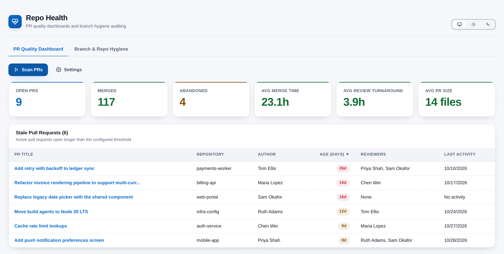
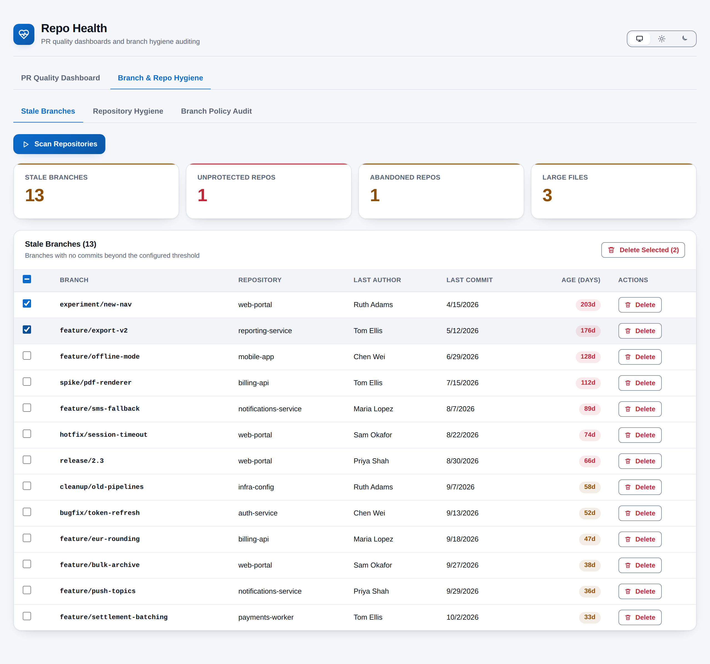

# Repo Health

**Are your repositories and review habits in good shape, and what needs cleaning up?** Repo Health answers both from one hub under **Repos > Repo Health**. A PR Quality Dashboard shows how fast pull requests move, how big they are and who carries the review load. A Branch & Repo Hygiene scanner finds stale branches, checks branch policies and flags repositories that need attention. Everything runs in your browser.

## What you get

### PR Quality Dashboard

- **Summary at a glance** -- open, merged and abandoned pull requests, with average merge time, review turnaround and PR size.
- **Stale pull requests** -- active PRs open longer than your threshold, sortable by age, author, repository or reviewers.
- **Weekly frequency** -- created vs merged PRs for each of the last 12 weeks.
- **PR size distribution** -- Small, Medium, Warning and Large buckets by files changed, with thresholds you choose.
- **Review load** -- the 15 busiest reviewers, so you can see who is carrying the team.
- **Contributor statistics** -- PRs authored and reviewed, PR size and comment activity per person.
- **Auto-complete tracking** -- how many merges used auto-complete.

### Branch & Repo Hygiene

- **Stale branches** -- branches with no commits for 30 days, with default and mainline branches always excluded.
- **Safe cleanup** -- delete one branch or a selection after a confirmation. A branch that received new commits since the scan is never deleted.
- **Branch policy audit** -- whether each default branch requires minimum reviewers, build validation and comment resolution, including policies inherited from the project.
- **Repository hygiene** -- missing `.gitignore`, unprotected default branches, repositories with no commits in 90 days, and files over 10 MB.

### Built for the Azure DevOps UI

- Follows your Azure DevOps light, dark or high-contrast theme, with a toggle to pin light or dark.
- Pass and fail are shown with icons and labels, never by colour alone, and both palettes meet WCAG AA contrast.
- Long scans show progress and can be cancelled.

## How it works

1. Open **Repos > Repo Health** in any project.
2. Press **Scan PRs** on the dashboard, or **Scan Repositories** on the hygiene tab.
3. The extension reads pull requests, branches, commits and branch policies for every repository in the project, directly from your organisation's Azure DevOps REST API, a few repositories at a time.
4. The results are computed and displayed in your browser. Adjust the PR thresholds under **Settings** and press **Save** to keep them for next time.

## Permissions, in plain words

- **Code (read and write)** -- to read repositories, pull requests, branches, commits and branch policies. The write part is used for one thing only: deleting a stale branch after you confirm it.
- **Extension data** -- to remember your dashboard settings.
- **Project** -- part of the standard permission set. The project is identified from the page you are on.

## Privacy

All analysis happens in the browser inside the Azure DevOps page. Repository data never leaves your Azure DevOps organisation, nothing is sent to any other service, and there is no telemetry. The only things stored are the dashboard settings you save (in the Azure DevOps Extension Data Service, shared across your organisation) and your theme preference (in your own browser).

## Requirements

- Azure DevOps Services, or Azure DevOps Server 2020 or later.
- Read access to the project's repositories. Deleting a branch also needs permission to delete branches in that repository.

## Support

Report problems or request features through GitHub Issues: https://github.com/adam-wheater/azure-devops-repo-health/issues

## License

Copyright © 2026 Adam Wheater. All rights reserved. This software is provided under a proprietary source-available license: you may read and audit the code and use the published extension, but you may not copy, modify, redistribute or republish it. See the LICENSE file for the full terms. The open source components it bundles keep their own licenses, listed in THIRD-PARTY-NOTICES.txt inside the package.
